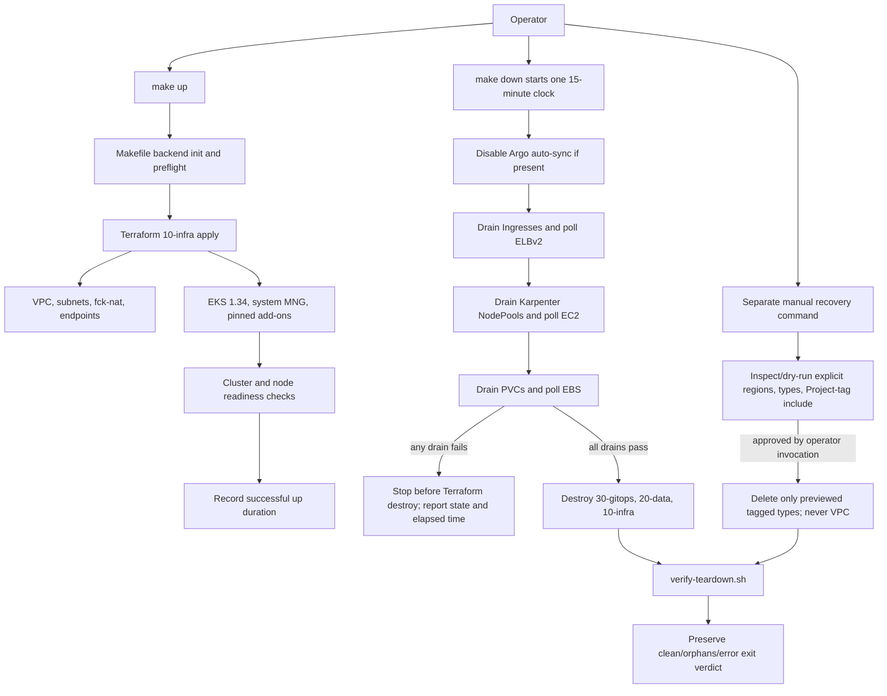

<user_constraints>
## User Constraints (from CONTEXT.md)

### Locked Decisions

#### Failed provisioning
- **D-01:** If `make up` fails after creating resources, leave the partial stack intact for inspection. Cleanup is explicit through `make down`; do not automatically destroy useful failure evidence.
- **D-02:** After diagnosing and fixing the cause, the operator reruns `make up` so Terraform can reconcile tracked resources. Do not add automatic provisioning retries.
- **D-03:** `make down` must support cleanup after a provisioning failure at any stage, including an incomplete or unhealthy cluster. On failure, identify the failed stage and safe next step, preserving the originating error output.

#### Drain failures and teardown deadline
- **D-04:** Stop `make down` on the first failed drain step and do not begin Terraform destroy. Report the failed step, last observed AWS/Kubernetes state, and elapsed time.
- **D-05:** After remediation, retry teardown by rerunning `make down` from its first step. Drain actions must therefore be safe to repeat. If all drains pass, continue automatically into Terraform destroy; do not add a confirmation prompt between drains and destroy.
- **D-06:** Use one hard 15-minute deadline for the teardown operation; drain polling shares the deadline rather than receiving independent limits that can stack. Do not provide a per-run deadline override. Retry transient AWS/API polling errors a bounded number of times within the same deadline; do not extend the deadline. Record successful teardown timings in `COSTS.md`; failed attempts are not part of the published timing series.

#### Last-resort recovery
- **D-07:** Use a scoped nuke tool for last-resort recovery instead of a project-owned bulk-deletion script or a manual-only runbook. Limit it to project-tagged resources; show a target preview but do not require a second confirmation. Invoke it only through a separate manual command, never automatically from `make down`.
- **D-08:** The recovery target boundary must not widen beyond project-tagged resources without a new decision. The teardown sweep deliberately checks untagged controller-created resources too; the scoped nuke may not remove those. It must report uncovered/orphaned resources for explicit handling rather than silently broadening deletion scope. Research/planning must determine whether a suitable tool can honor this boundary.

### the agent's Discretion
- Select the specific scoped nuke tool after verifying its target filtering and preview behavior.
- Choose polling intervals, AWS error classification, command output formatting beyond the required failure summary, and safe no-op handling for resources absent after a partial `make up`, provided the locked stop/timeout behavior and repeatable teardown contract are preserved.

### Deferred Ideas (OUT OF SCOPE)
None — discussion stayed within Phase 2 scope.
</user_constraints>

<phase_requirements>
## Phase Requirements

| ID | Description | Research Support |
|----|-------------|------------------|
| LIFE-01 | Operator can provision the entire stack with a single `make up` completing in 20 minutes or less | Separate local Terraform validation from two measured live `make up` runs; log successful durations to COSTS.md. [VERIFIED: .planning/REQUIREMENTS.md:28] |
| LIFE-02 | Operator can destroy every billable resource with a single `make down` completing in 15 minutes or less | One monotonic deadline must cover drains and all layer destroys; live timing is a phase gate, not inferred from unit tests. [VERIFIED: .planning/REQUIREMENTS.md:29] |
| LIFE-03 | `make down` executes an explicit ordered sequence — disable Argo auto-sync, drain Ingresses, drain Karpenter NodePools, drain PVCs, destroy L3→L2→L1, verify — rather than a bare `terraform destroy` | Preserve all eight named actions in the listed order; resolve the roadmap's seven-versus-eight count without dropping an action. [VERIFIED: .planning/REQUIREMENTS.md:30; .planning/phases/02-ephemeral-infrastructure-drain-scripts/02-CONTEXT.md:73-74] |
| LIFE-04 | Each drain step polls to an AWS-API-confirmed terminal state rather than firing and forgetting, because `kubectl delete ingress` returns before the ALB is gone | For each drain, define an AWS-side completion predicate, distinguish absence from API errors, and poll within the shared deadline. [VERIFIED: .planning/REQUIREMENTS.md:31] |
| LIFE-06 | Operator can complete two consecutive clean up/down round-trips on an empty cluster with zero orphans before any application code is written | Record each successful up/down duration and verifier result; no application code until both rounds pass. [VERIFIED: .planning/REQUIREMENTS.md:33] [VERIFIED: .planning/ROADMAP.md:94] [VERIFIED: .planning/ROADMAP.md:101] |
| NET-01 | VPC spans 2 availability zones with `/20` private subnets sized to survive VPC CNI warm-pool IP consumption | Use two AZs and the reserved CIDR design already documented; verify pod IP allocation in a live cluster. [VERIFIED: .planning/REQUIREMENTS.md:41; .planning/research/ARCHITECTURE.md:232-250] |
| NET-02 | Intra subnets with no default route host the data stores | Do not put a default route in the intra route tables; gateway endpoint prefix-list routes are not a default route. [VERIFIED: .planning/REQUIREMENTS.md:42; .planning/research/ARCHITECTURE.md:240-250] |
| NET-03 | A fck-nat `t4g.nano` ASG provides egress, with route tables targeting the ENI rather than an instance ID so replacement does not break routing | Use the pinned fck-nat module route ownership pattern; verify ASG replacement and both private route tables live. [VERIFIED: .planning/REQUIREMENTS.md:43; .planning/research/ARCHITECTURE.md:250-253] |
| NET-04 | S3 and DynamoDB gateway endpoints are enabled (free); the S3 endpoint is mandatory because ECR image layers are served from S3 | Create both gateway endpoints and attach the intended route tables; keep ECR image pulls in the up acceptance test. [VERIFIED: .planning/REQUIREMENTS.md:44; .planning/research/ARCHITECTURE.md:256-260] |
| NET-05 | Interface VPC endpoints are available behind a default-off flag, with their real cost documented, so the operator can enable them for one deliberate comparison session | Put interface endpoints behind an explicit false-by-default input and record observed/priced cost in COSTS.md. [VERIFIED: .planning/REQUIREMENTS.md:45; .planning/research/ARCHITECTURE.md:256-270] |
| NET-07 | Subnet discovery tags use a deterministic cluster name so the AWS Load Balancer Controller finds subnets on every rebuild | Keep public/internal role tags and the fixed cluster discovery tag in the VPC module inputs. Architecture source values: `kubernetes.io/role/elb = 1`, `kubernetes.io/role/internal-elb = 1`, and `karpenter.sh/discovery = <cluster-name>`. [VERIFIED: .planning/REQUIREMENTS.md:47] [VERIFIED: .planning/research/ARCHITECTURE.md:247-253] |
| EKS-01 | Cluster is pinned to Kubernetes 1.34 and never floats, provisioned by `terraform-aws-modules/eks` v21 | Pin module 21.26.0 and Kubernetes minor 1.34; AWS patch is service-managed and must be observed. [VERIFIED: .planning/REQUIREMENTS.md:51; VERSIONS.md:13] |
| EKS-02 | A system managed node group runs on on-demand instances, tainted `CriticalAddonsOnly`, hosting CoreDNS, the ALB Controller, Karpenter, and Argo CD controllers | Plan an on-demand managed node group and verify its taint, capacity, and platform placement; settle whether controllers are installed in this phase or only hosted by this node group. [VERIFIED: .planning/REQUIREMENTS.md:52] |
| EKS-04 | Karpenter's AWS-side resources (IAM, interruption SQS queue, EventBridge rules) are defined in Terraform, not the upstream CloudFormation template | Use the pinned EKS module's Karpenter submodule or explicit Terraform resources; do not run the upstream CloudFormation bootstrap. [VERIFIED: .planning/REQUIREMENTS.md:54; .planning/research/ARCHITECTURE.md:137] |
| EKS-08 | EKS managed addons including the Pod Identity Agent are installed and version-pinned | Set explicit `addon_version` for each managed add-on; use the live 1.34 compatibility results below and mirror chosen versions into VERSIONS.md. [VERIFIED: .planning/REQUIREMENTS.md:58] |
| OWN-02 | The Terraform `kubernetes` and `helm` providers are absent from every layer except `30-gitops`, so no layer requires a live API server at plan time | L1 owns AWS resources only; drain scripts may call `kubectl`, but Terraform providers in L1 must not require the live cluster. [VERIFIED: .planning/REQUIREMENTS.md:63; .planning/research/ARCHITECTURE.md:126] |
</phase_requirements>

## Project Constraints (from copilot-instructions.md)

- Use gsd-core and load the matching skill for explicit GSD requests; this request is explicitly a Phase 2 research task. [VERIFIED: .github/copilot-instructions.md]
- Treat `/gsd-*` and `gsd-*` as command invocations and load the matching `.github/skills/gsd-*` file. [VERIFIED: .github/copilot-instructions.md]
- When a command says to spawn a subagent, prefer a matching custom agent from `.github/agents`. No subagent was required for this research task. [VERIFIED: .github/copilot-instructions.md]
- Do not apply GSD workflows unless the user explicitly asks. [VERIFIED: .github/copilot-instructions.md]
- After completing any `gsd-*` command (or any deliverable it triggers: feature, bug fix, tests, docs, etc.), ALWAYS: (1) offer the user the next step by prompting via `ask_user`; repeat this feedback loop until the user explicitly indicates they are done. [VERIFIED: .github/copilot-instructions.md]
- The project skill scan found the `gsd-plan-phase` workflow skill relevant to this deliverable; no infrastructure-specific skill was identified. [VERIFIED: .github/skills/gsd-plan-phase/SKILL.md; .github/gsd-core/references/project-skills-discovery.md]

# Phase 02: Ephemeral Infrastructure & Drain Scripts - Research

**Researched:** 2026-10-14
**Domain:** Terraform AWS infrastructure, EKS lifecycle orchestration, safe recovery
**Confidence:** MEDIUM overall. Exact module pins and local contracts were read from source-of-truth files; live AWS version APIs were queried. The documentation fetch tier classified `webfetch` and `aws-cli` as LOW, and the fck-nat tag source could not be re-fetched during this session, so external claims are cited, not represented as independently verified.

## Summary

Use the locked module versions, keep L1 wholly AWS/Terraform-owned, and implement `make up`/`make down` as thin Makefile orchestration around Terraform plus idempotent Bash drains. For reproducibility, set explicit EKS managed add-on versions rather than inheriting EKS module v21's moving `most_recent` default; current us-east-1 candidates for Kubernetes 1.34 are listed below. [VERIFIED: VERSIONS.md:12-14] The ledger records verbatim `version = "6.7.3"`, `version = "21.26.0"`, and `version = "1.6.1"` for VPC, EKS, and fck-nat respectively.

Keep the EKS 1.34 choice unchanged, but treat its support boundary as urgent: the live EKS API reports standard support ending 2026-12-02 and extended support ending 2027-12-02. The phase must finish its two clean round-trips before application code; it must not silently change the locked Kubernetes minor to make the date easier. [CITED: https://docs.aws.amazon.com/eks/latest/APIReference/API_DescribeClusterVersions.html; AWS CLI response queried 2026-10-14]

**Primary recommendation:** plan the immutable infrastructure and the teardown gate together. Pin provider/module/add-on and (if rebuild identity requires it) node AMI versions; implement one shared 15-minute monotonic teardown deadline; wait for AWS-observed absence/terminal states; then run the existing verifier and preserve its three-way exit contract. `sh/verify-teardown.sh` defines `readonly EXIT_CLEAN=0`, `readonly EXIT_ORPHANS=1`, and `readonly EXIT_ERROR=2`. [VERIFIED: sh/verify-teardown.sh:6-8] Keep Cloud Nuke as a separate, manual, preview-first candidate; never enable VPC deletion because its own documentation says VPC cleanup deletes dependent ENIs, security groups, and other resources regardless of their separate tag selections. [CITED: EKS module v21.26.0 UPGRADE-21.0.md; Cloud Nuke v0.52.0 CLI/configuration docs]

Project state still records Phase 1 verification as `human_needed`; this research does not mark that prerequisite or either Phase 2 round-trip as passed. [VERIFIED: .planning/STATE.md:5-7] [VERIFIED: .planning/STATE.md:114] The state file records verbatim: `current_phase: 01`, `status: executing`, and "Phase verifier returned `human_needed` in `01-VERIFICATION.md` (3/5 roadmap truths verified)."

## Architectural Responsibility Map

| Capability | Primary Tier | Secondary Tier | Rationale |
|------------|-------------|----------------|-----------|
| `make up`/`make down` sequencing and shared deadline | API / Backend (operator CLI) | — | Make/Bash own ordering, retries, summaries, and the wall-clock deadline; Terraform owns cloud resources. [VERIFIED: .planning/phases/02-ephemeral-infrastructure-drain-scripts/02-CONTEXT.md:22-24] |
| VPC, routes, fck-nat, gateway/interface endpoints | API / Backend (Terraform) | Network | Terraform is the source of truth; AWS networking provides runtime routing. [VERIFIED: .planning/research/ARCHITECTURE.md:137] [VERIFIED: .planning/research/ARCHITECTURE.md:220-270] |
| EKS cluster, managed node group, EKS add-ons, Karpenter AWS resources | API / Backend (Terraform/AWS EKS) | Kubernetes control plane | EKS APIs own control-plane lifecycle; Kubernetes commands are used only for drain operations, not Terraform plan/apply. [VERIFIED: .planning/REQUIREMENTS.md:51-63] |
| Ingress/NodePool/PVC drain | Kubernetes API | ELBv2, EC2, EBS APIs | Kubernetes deletion is asynchronous; completion must be proven by the corresponding AWS resource state. [VERIFIED: .planning/REQUIREMENTS.md:30-31] |
| Orphan and final-account verification | API / Backend (AWS CLI verifier) | Database / Storage | Existing teardown verifier enumerates AWS resources and distinguishes clean, orphan, and error verdicts. [VERIFIED: .planning/phases/02-ephemeral-infrastructure-drain-scripts/02-CONTEXT.md:45-64] |

## Standard Stack

### Core

| Library / tool | Version | Purpose | Why standard |
|----------------|---------|---------|--------------|
| Terraform CLI | 1.16.4 | Plan/apply/destroy the layers | Exact project pin; use Makefile targets for init. The convention says verbatim: "Run Terraform initialization only through the Makefile." [VERIFIED: VERSIONS.md:9-10] [VERIFIED: docs/CONVENTIONS.md:30] |
| `hashicorp/aws` | 6.66.0 | AWS resources and data sources | Exact project pin; EKS module floor is satisfied. [VERIFIED: VERSIONS.md:11] [VERIFIED: VERSIONS.md:39] |
| `terraform-aws-modules/eks/aws` | 21.26.0 | Cluster, managed node group, access entries, managed add-ons | Locked in VERSIONS.md. v21 removes the `aws-auth` submodule and Karpenter IRSA path; use access entries and Pod Identity patterns. [VERIFIED: VERSIONS.md:13; CITED: https://raw.githubusercontent.com/terraform-aws-modules/terraform-aws-eks/v21.26.0/docs/UPGRADE-21.0.md] |
| `terraform-aws-modules/vpc/aws` | 6.7.3 | VPC, public/private/intra subnets, routes, endpoints | Locked module; v6.7.3 requires AWS provider >=6.28, satisfied by the pinned provider. [VERIFIED: VERSIONS.md:12; CITED: https://raw.githubusercontent.com/terraform-aws-modules/terraform-aws-vpc/v6.7.3/README.md] |
| `RaJiska/fck-nat/aws` | 1.6.1 | Low-cost NAT instance/ASG and persistent-ENI egress | Locked module and project route pattern; direct upstream fetch reset this session, so validate its exact v1.6.1 input/output contract before writing HCL. [VERIFIED: VERSIONS.md:14; VERIFIED: .planning/research/ARCHITECTURE.md:250-253] |
| `hashicorp/time`, `hashicorp/tls` | floors `>=0.9`, `>=4.0`; exact pins unresolved | EKS module provider dependencies | The project requires exact provider pins, but VERSIONS.md currently records floors only and L1 declares only `hashicorp/aws`. Resolve exact registry releases and add them to both files before `make validate`. [VERIFIED: VERSIONS.md:32-39; layers/10-infra/versions.tf:1-10] |

### EKS 1.34 managed add-on candidates

The following values are from `aws eks describe-addon-versions --region us-east-1 --kubernetes-version 1.34`, queried read-only on 2026-10-14. Each returned `clusterVersion` is `1.34` and `platformVersions` is `*`. These are the highest versions in the compatible response when sorted by version, not a claim that AWS marks each as the default. [CITED: https://docs.aws.amazon.com/eks/latest/APIReference/API_DescribeAddonVersions.html; CLI response 2026-10-14]

| Add-on | Exact compatible candidate | `defaultVersion` | IAM required | Planning note |
|--------|----------------------------|-----------------|--------------|---------------|
| `vpc-cni` | `v1.23.2-eksbuild.3` | false | yes | Create an explicit CNI role/association; do not assume a version pin supplies IAM permissions. |
| `kube-proxy` | `v1.34.6-eksbuild.49` | false | no | Pin explicitly. |
| `coredns` | `v1.13.2-eksbuild.51` | false | no | Pin explicitly; this version includes a PDB, so drain/upgrade tests must account for it. |
| `eks-pod-identity-agent` | `v1.4.0-eksbuild.4` | false | no | Required to use EKS Pod Identity on EC2 nodes. |
| `aws-ebs-csi-driver` | `v1.67.0-eksbuild.1` | true | yes | Queried but explicitly excluded from Phase 2; PVC drain behavior uses Wave 5 AWS/EBS fixtures, not a live CSI installation or PVC claim. |

Observed output, quoted verbatim for checkability: `vpc-cni v1.23.2-eksbuild.3`; `kube-proxy v1.34.6-eksbuild.49`; `coredns v1.13.2-eksbuild.51`; `eks-pod-identity-agent v1.4.0-eksbuild.4`; `aws-ebs-csi-driver v1.67.0-eksbuild.1`. Phase 2 selects and pins only the first four for EKS-08; the EBS CSI candidate is explicitly not installed because no Phase 2 workload requires a PVC. The queried EBS CSI candidate returned `defaultVersion=true`; the first four returned `defaultVersion=false`. The live API is a better pin source than a static version table, which can lag. [CITED: AWS EKS DescribeAddonVersions API; queried 2026-10-14]

### Supporting tools

| Tool | Local availability | Use |
|------|--------------------|-----|
| AWS CLI | 2.37.7; `AWS_PROFILE=microservices-demo` successfully queried read-only EKS APIs | Provisioning, EKS/ELBv2/EC2/EBS polling, verifier. |
| `kubectl` | v1.37.0 installed | Drain operations; validate client/server skew before use against EKS 1.34 and pin/use a compatible client for acceptance. [ASSUMED: local client is too new for a 1.34 server; official skew page could not be fetched this session.] |
| `jq` | 1.7.1 | Parse AWS API JSON structurally; never scrape display tables. |
| Bats | 1.14.0 | Unit/contract tests with existing shared stubs and fixtures. |
| ShellCheck | 0.11.0 | Lint Bash scripts; already part of `make validate`. |
| Cloud Nuke | v0.52.0 upstream release; not installed locally | Separate manual recovery candidate; pin the release asset/checksum only after per-type safety proof. [CITED: https://api.github.com/repos/gruntwork-io/cloud-nuke/releases/latest] |

### Version and module-specific patterns

- **EKS v21 breaking changes:** Terraform >=1.5.7, AWS provider >=6.59, `time >=0.9`, `tls >=4.0`; `aws-auth` submodule removed; Karpenter IRSA support removed in favor of Pod Identity; add-on defaults changed to `most_recent=true` and `resolve_conflicts_on_create="NONE"`; the OIDC issuer hostname changed. Use v21 variable names, `access_entries`, and the v21 Karpenter/Pod Identity inputs, not v19/v20 examples. [VERIFIED: .planning/research/ARCHITECTURE.md:126; CITED: EKS v21.26.0 UPGRADE-21.0.md]
- **Add-on pinning:** v21's `addons` object defaults `most_recent` to true and `resolve_conflicts_on_create` to `NONE`; set `addon_version` explicitly to each selected 1.34-compatible string and set `most_recent=false` to make the decision visible. [CITED: https://raw.githubusercontent.com/terraform-aws-modules/terraform-aws-eks/v21.26.0/variables.tf]
- **EKS encryption and teardown:** module v21 defaults `create_kms_key=true`, `encryption_config={}`, and a 30-day KMS deletion window. The upgrade guide says `encryption_config=null` disables the module-managed customer key; EKS still encrypts Kubernetes secrets at rest by default. Prefer `encryption_config=null` for a daily ephemeral cluster unless customer-managed KMS is an explicit learning objective; otherwise the key remains pending deletion after Terraform destroy. [CITED: EKS v21.26.0 variables.tf and UPGRADE-21.0.md]
- **EKS control-plane logs:** module default log-group retention is 90 days; the project convention says verbatim `retention_in_days = 1`. Override the EKS module retention input. [CITED: EKS v21.26.0 variables.tf; VERIFIED: docs/CONVENTIONS.md:8]
- **Managed node group AMI:** v21 changed the default to AL2023 and defaults `use_latest_ami_release_version=true`, which follows a moving SSM parameter. The current us-east-1 SSM value for the 1.34 AL2023 x86_64 standard image is `1.34.11-202610033-eks-1.34-release`; use an exact `ami_release_version` if rebuild identity is more important than automatic patch uptake, and mirror it into VERSIONS.md. [CITED: EKS v21.26.0 UPGRADE-21.0.md; AWS SSM get-parameter response 2026-10-14]
- **VPC v6.7.3:** use the module's public, private, and intra subnet lists; set `enable_nat_gateway=false`; pass per-tier tags through `public_subnet_tags`/`private_subnet_tags`; use the `vpc-endpoints` submodule for S3 and DynamoDB gateway endpoints. Use a separate conditional instance of the endpoint submodule for interface endpoints so the default remains off. [CITED: https://raw.githubusercontent.com/terraform-aws-modules/terraform-aws-vpc/v6.7.3/examples/complete/main.tf; https://raw.githubusercontent.com/terraform-aws-modules/terraform-aws-vpc/v6.7.3/modules/vpc-endpoints/main.tf]
- **fck-nat 1.6.1:** the existing project architecture records this route contract:

> - **Both** private route tables get `0.0.0.0/0 → <fck-nat ENI>`. The target must be the **ENI**, not the instance id (ENI survives instance replacement; the ASG re-attaches it). `source_dest_check = false` is mandatory.
> - Use `RaJiska/fck-nat` v1.6.1 with `update_route_table_ids` — let the module own the routes. If you also declare those routes in your own `aws_route` resources you get a permanent diff and a teardown race.

Do not create duplicate `aws_route` resources. The v1.6.1 upstream input schema and AMI/HA defaults remain a verification checkpoint because the source fetch reset. [VERIFIED: .planning/research/ARCHITECTURE.md:250-253] [ASSUMED: exact upstream schema/defaults not re-fetched]

**Version verification:** All three module versions and Terraform/AWS provider versions are exact project pins. The live AWS queries above verified current 1.34 add-on candidates and SSM AMI release. The exact `time` and `tls` provider versions are not yet pinned; registry lookup is required before initializing the new EKS module.

## Package Legitimacy Audit

No npm, PyPI, or crates package is recommended. Cloud Nuke is a standalone Go binary candidate, not an application library. The official GitHub release API reports `v0.52.0`, published 2026-06-13, with a SHA-256 digest for its macOS arm64 asset of `sha256:366d209ce427d25342542f4304bc1eb6987daa6561823e761336bc9edfdb710d`. Pin that release and verify its checksum if approved; do not install a floating `latest` binary. [CITED: https://api.github.com/repos/gruntwork-io/cloud-nuke/releases/latest]

| Tool | Registry/source | Version/age | Verdict | Disposition |
|------|-----------------|-------------|---------|-------------|
| Cloud Nuke | Official Gruntwork GitHub release | `v0.52.0`, published 2026-06-13 | Candidate; not installed | Use only after the per-type allowlist and cascade test below pass; manual command only. |

**Packages removed due to SLOP verdict:** none.
**Packages flagged SUS:** none. No Terraform module or Go package legitimacy verdict was available from the configured npm/PyPI/crates gate; exact Terraform module pins are project-locked and the binary comes from its official release.

## Architecture Patterns

### System Architecture Diagram



The diagram preserves the full listed order. The roadmap says “seven named ordered steps,” but the enumerated actions are disable Argo sync, three drains, three destroys, and verify: eight actions (numbered 0 through 7 in the architecture). Keep all eight and clarify the count in the plan; do not merge away the final verifier or a drain. [VERIFIED: .planning/ROADMAP.md:95; .planning/research/ARCHITECTURE.md:175-190; .planning/phases/02-ephemeral-infrastructure-drain-scripts/02-CONTEXT.md:73-74]

### Recommended Project Structure

```text
layers/10-infra/
  versions.tf             # exact Terraform/provider pins, default tags, partial S3 backend
  vpc.tf                  # VPC module and gateway endpoints
  nat.tf                  # fck-nat module and ENI route ownership
  eks.tf                  # EKS module, access entries, MNG, pinned add-ons
  karpenter.tf            # Terraform-owned IAM, queue, and EventBridge resources
sh/
  drain-ingress.sh
  drain-nodes.sh
  drain-pvcs.sh
tests/
  phase2_lifecycle.bats   # Make sequence, deadlines, AWS polling, partial-state tests
```

This is a recommended decomposition, not a claim that these files already exist. The Phase 2 context says verbatim:

> There are no Phase 2 drain scripts or `make up`/`make down` targets yet.

[VERIFIED: .planning/phases/02-ephemeral-infrastructure-drain-scripts/02-CONTEXT.md:77] It also requires Terraform init to remain Makefile-driven and identifies the teardown verifier as the final consumer. [VERIFIED: .planning/phases/02-ephemeral-infrastructure-drain-scripts/02-CONTEXT.md:49-67]

### Pattern 1: Build the L1 module graph without a provider seam

Keep VPC, EKS, system managed node group, EKS add-ons, IAM/Pod Identity, and Karpenter AWS-side resources together in the per-session L1 state. The local architecture records the exact state key as `infra/terraform.tfstate` and the layer boundary as `layers/10-infra`. Its source row reads:

> | L1 | `layers/10-infra` | `infra/terraform.tfstate` | Per session | VPC, subnets, RTs, fck-nat, gateway endpoints, SGs, EKS control plane, system node group, EKS addons, all IAM/Pod-Identity, Karpenter AWS side |

[VERIFIED: .planning/research/ARCHITECTURE.md:130-137]

Do not add `kubernetes` or `helm` providers to L1. The layer file says verbatim `required_version = "= 1.16.4"`, `version = "= 6.66.0"`, and tags `Project = var.project`, `Layer = "10-infra"`, `ManagedBy = "terraform"`, `Environment = var.environment`; it currently declares no exact `time` or `tls` constraints. [VERIFIED: layers/10-infra/versions.tf:1-21] The provider-floor row reads:

> | `terraform-aws-modules/eks` 21.x | Terraform >= 1.5.7, `aws` >= 6.59, `time` >= 0.9, `tls` >= 4.0 |

[VERIFIED: VERSIONS.md:32-39] The EKS module README also records these floors. [VERIFIED: .planning/research/ARCHITECTURE.md:126]

### Pattern 2: Pin managed add-ons instead of inheriting `most_recent`

```hcl
addons = {
  "vpc-cni" = {
    addon_version = "v1.23.2-eksbuild.3"
    most_recent   = false
  }
  "kube-proxy" = {
    addon_version = "v1.34.6-eksbuild.49"
    most_recent   = false
  }
  "coredns" = {
    addon_version = "v1.13.2-eksbuild.51"
    most_recent   = false
  }
  "eks-pod-identity-agent" = {
    addon_version = "v1.4.0-eksbuild.4"
    most_recent   = false
  }
}
```

These are the live us-east-1 candidates returned by the AWS EKS add-on compatibility API on 2026-10-14; re-query at plan/apply time and store the chosen exact versions in VERSIONS.md. Phase 2 pins `vpc-cni`, `kube-proxy`, `coredns`, and `eks-pod-identity-agent` for EKS-08; EBS CSI is excluded, so no CSI IAM association or add-on is in scope. PVC drain behavior is exercised with Wave 5 sequential AWS/EBS fixtures, not a live PVC claim. VPC CNI requires IAM permissions. EKS module source accepts `addon_version`, `most_recent`, and `pod_identity_association`; use Pod Identity associations for required service accounts instead of granting broad permissions to the node role. [CITED: AWS DescribeAddonVersions API; https://raw.githubusercontent.com/terraform-aws-modules/terraform-aws-eks/v21.26.0/variables.tf]

### Pattern 3: Shared deadline and explicit AWS state predicates

Use one monotonic deadline created once at `make down` entry. Each script receives the same deadline/remaining budget, retries only transient AWS errors a bounded number of times, and clips connect/read timeouts to remaining time. A timeout, authorization error, malformed JSON, or unknown state is a failure, never evidence of absence. Drain scripts must be repeatable and a failure must preserve the original command output and report the step, last observed AWS/Kubernetes state, and elapsed time. [VERIFIED: .planning/phases/02-ephemeral-infrastructure-drain-scripts/02-CONTEXT.md:22-24]

For an Ingress/LoadBalancer deletion, the completion condition is no target ALB/target groups in the target VPC according to ELBv2 APIs, not a successful `kubectl delete`. For Karpenter, poll AWS EC2 for the project's tagged capacity to terminate; for PVCs, poll until their EBS volumes are absent. Confirm the exact AWS predicates and terminal states against current EKS/ELBv2/EC2/EBS APIs before implementing; upstream drain docs could not be fetched during this session. [VERIFIED: .planning/REQUIREMENTS.md:30-31; VERIFIED: .planning/research/ARCHITECTURE.md:175-215; ASSUMED: exact response/error classification still requires API-doc check]

### Pattern 4: Cloud Nuke as a bounded, separate recovery command

Cloud Nuke v0.52.0 documents `inspect-aws`, `--dry-run`, repeatable `--resource-type`, per-resource `include.tags`, and `--force`. Use a wrapper that previews the exact target list and then executes only the same explicit region/type set with the positive `Project` tag include. The project's exact Project tag value is `microservices-demo`; source says `default = "microservices-demo"`. [CITED: Cloud Nuke v0.52.0 docs/cli-usage.md and docs/configuration.md; VERIFIED: layers/10-infra/variables.tf:7-11]

```yaml
EC2:
  include:
    tags:
      Project: "microservices-demo"
```

Do not run the tool's default `cloud-nuke aws` target, do not let command-line type selection drift from the preview, and do not enable the `vpc` resource type. Cloud Nuke's VPC cleanup explicitly deletes dependencies including ENIs, VPC endpoints, subnets, route tables, network ACLs, and security groups; those can include untagged controller-created resources, violating D-08. Leave uncovered resources to `verify-teardown.sh` and explicit handling. [CITED: Cloud Nuke v0.52.0 docs/cli-usage.md; VERIFIED: .planning/phases/02-ephemeral-infrastructure-drain-scripts/02-CONTEXT.md:27-28]

### Anti-Patterns to Avoid

- Do not treat successful `kubectl delete` as AWS teardown completion. [VERIFIED: .planning/REQUIREMENTS.md:31]
- Do not let every polling loop start a new timeout; this breaks D-06's global deadline. [VERIFIED: .planning/phases/02-ephemeral-infrastructure-drain-scripts/02-CONTEXT.md:24]
- Do not set EKS module `most_recent=true` for add-ons while claiming EKS-08 is version-pinned. [CITED: EKS v21.26.0 variables.tf; VERIFIED: .planning/REQUIREMENTS.md:58]
- Do not create Terraform-managed NAT routes alongside fck-nat-owned routes. [VERIFIED: .planning/research/ARCHITECTURE.md:252-253]
- Do not create interface endpoints by default or put data stores in private subnets with NAT routes. [VERIFIED: .planning/REQUIREMENTS.md:42] [VERIFIED: .planning/REQUIREMENTS.md:45] [VERIFIED: .planning/research/ARCHITECTURE.md:240-270]
- Do not allow a failed/unknown drain to fall through to Terraform destroy, suppress the verifier's exit `2`, or automatically invoke Cloud Nuke. [VERIFIED: .planning/phases/02-ephemeral-infrastructure-drain-scripts/02-CONTEXT.md:22-28]

## Don't Hand-Roll

| Problem | Don't build | Use instead | Why |
|---------|-------------|-------------|-----|
| EKS cluster/node-group/access-entry resources | Custom raw Terraform for the whole cluster | Locked EKS module v21.26.0 | The module contains version-specific access-entry, add-on, node-group, and Pod Identity semantics. |
| VPC and subnet graph | Bespoke route/subnet module | Locked VPC module v6.7.3 | The project needs mature public/private/intra subnet, route-table, tagging, and endpoint behavior. |
| NAT lifecycle and ENI routing | Custom ASG/user-data/route-reassociation implementation | Locked RaJiska/fck-nat module v1.6.1 | Keep the persistent ENI and module-owned routes; validate its exact release schema before use. |
| Last-resort bulk deletion | Project-owned account sweeper or an all-account `aws-nuke` wrapper | Scoped Cloud Nuke candidate with explicit positive tags, preview, and resource-type allowlist | D-07/D-08 require a tool, a preview, and no deletion of untagged resources. Cloud Nuke's VPC cascade is excluded. |
| Generic orchestration framework | New workflow engine | Make + focused Bash scripts + AWS CLI/jq | The custom code should be limited to the project-specific ordering, shared deadline, state summaries, and fail-closed semantics. |

**Key insight:** the difficult part is not creating an EKS cluster; it is proving that every asynchronous controller/AWS side effect is gone before the VPC is destroyed, while preserving failure evidence and not expanding recovery scope. [VERIFIED: .planning/research/PITFALLS.md:1-35; .planning/phases/02-ephemeral-infrastructure-drain-scripts/02-CONTEXT.md:17-28]

## Common Pitfalls

### 1. Seven steps versus eight actions

The roadmap says “seven named ordered steps,” but the sequence has eight actions: disable sync, 3 drains, 3 destroys, verify. Keep all actions in order and clarify the count in the plan. [VERIFIED: .planning/ROADMAP.md:95; .planning/research/ARCHITECTURE.md:175-190]

### 2. Partial/unhealthy cluster recovery conflicts with stop-before-destroy

D-03 requires cleanup after any provisioning stage, including an incomplete/unhealthy cluster. D-04 prohibits Terraform destroy after the first failed drain. If the Kubernetes API is unreachable while AWS still reports an EKS cluster or node group, a normal `kubectl` drain cannot prove completion; blindly continuing violates D-04, but permanently stopping does not satisfy D-03. The plan must define an AWS-API recovery branch whose state predicates still count as successful drain completion, or explicitly surface the stage as blocked and the precise safe remediation. Do not resolve this by automatically destroying after a drain failure. [VERIFIED: .planning/phases/02-ephemeral-infrastructure-drain-scripts/02-CONTEXT.md:19] [VERIFIED: .planning/phases/02-ephemeral-infrastructure-drain-scripts/02-CONTEXT.md:22-24]

### 3. A no-op empty-cluster test does not validate drains

The two required round-trips begin on an empty cluster; they can pass with all three drains as no-ops. The roadmap also asks to demonstrate an ALB disappearing while the drain waits. Plan a temporary, non-application ingress/controller probe or an equivalent live fixture, and tear it down before the two zero-orphan round-trips. Clarify whether LBC/Karpenter/Argo controllers are installed in Phase 2 or only hosted by the node group. [VERIFIED: .planning/ROADMAP.md:93-95; .planning/REQUIREMENTS.md:52]

### 4. The hard deadline is likely the feasibility bottleneck

ALB deletion, node-group termination, EKS control-plane deletion, and Terraform dependency teardown are sequential in the locked order. One 15-minute total budget leaves no independent timeout for each stage. Instrument every stage and the total, test transient retries against remaining time, and treat an AWS service operation that cannot finish as a failed gate rather than extending the deadline. Actual feasibility is not measured yet. [VERIFIED: .planning/phases/02-ephemeral-infrastructure-drain-scripts/02-CONTEXT.md:22-24; ASSUMED: budget feasibility]

### 5. EKS 1.34 support boundary is close

Live EKS version metadata says `endOfStandardSupportDate="2026-12-02T07:00:00+07:00"`, `endOfExtendedSupportDate="2027-12-02T07:00:00+07:00"`, and current patch `1.34.11`. Standard support ends less than two months after the research date. Keep the locked minor; finish the phase gate before the boundary or explicitly accept extended-support cost. The exact extended-support hourly rate was not verified in this session. [CITED: AWS DescribeClusterVersions API; queried 2026-10-14]

### 6. EKS module defaults can create slow or floating resources

The v21 module creates a customer KMS key by default with a 30-day deletion window and defaults node AMI lookup to the latest SSM release. Set `encryption_config=null` if a customer key is not a learning requirement; decide whether to pin the current AL2023 release. Set CloudWatch log retention to one day instead of the module's 90-day default. [CITED: EKS v21.26.0 variables.tf and UPGRADE-21.0.md; VERIFIED: docs/CONVENTIONS.md]

### 7. Operator kubectl reachability is an architecture dependency

The installed client is v1.37.0 and the target cluster minor is 1.34. EKS module v21 defaults the API endpoint to private access enabled/public access disabled. A local operator cannot run the locked drains unless an approved path to the private API exists or public endpoint access is restricted to a trusted operator CIDR. Select and security-review the path before implementation; do not casually open `0.0.0.0/0`. [CITED: EKS v21.26.0 variables.tf; local tool/API probes 2026-10-14; ASSUMED: operator is outside the VPC during normal local `make down`]

### 8. Cloud Nuke's VPC type crosses D-08

Cloud Nuke documents recursive VPC dependency cleanup. A Project-tag include at the VPC type does not protect untagged dependent ENIs/SGs that the VPC cleanup itself deletes. Exclude VPC, preview the same explicit type/region list that will execute, and integration-test each allowed type's delete/cascade behavior. If the scope cannot be proven, keep that type report-only. [CITED: Cloud Nuke v0.52.0 docs/cli-usage.md; VERIFIED: 02-CONTEXT.md:27-28]

## State of the Art

| Previous approach | Current v21.26.0 approach | Impact |
|-------------------|--------------------------|--------|
| `aws-auth` submodule/ConfigMap ownership | EKS access entries | Use `access_entries`; do not add the removed submodule or Kubernetes provider to L1. [CITED: EKS UPGRADE-21.0.md] |
| Karpenter IRSA role wiring | EKS Pod Identity integration | Use the v21 Pod Identity association contract; ensure the Pod Identity Agent add-on is version-pinned. [CITED: EKS UPGRADE-21.0.md] |
| Implicit newest managed add-ons | `most_recent=true` is the v21 default | Override with exact 1.34-compatible `addon_version` values to satisfy EKS-08. [CITED: EKS v21.26.0 variables.tf; VERIFIED: REQUIREMENTS.md:58] |
| Floating managed node AMI release | `use_latest_ami_release_version=true` default | Exact release pin is needed for deterministic images; otherwise document deliberate automatic patch uptake. [CITED: EKS UPGRADE-21.0.md] |
| `terraform destroy` alone | Explicit controller drains, reverse-layer destroy, final sweep | Required because controllers create resources not in Terraform state. [VERIFIED: ARCHITECTURE.md:175-215; PITFALLS.md:70-100] |
| Exclusion-only nuking or all-account defaults | Positive tag include + explicit type allowlist + preview | Candidate Cloud Nuke pattern; VPC type excluded due cascade. [CITED: Cloud Nuke v0.52.0 docs] |

## Assumptions Log


## Open Questions

1. **How does `make down` clean up an EKS cluster that is unhealthy/incomplete while honoring D-04?** Define an AWS-API-confirmed branch for absent, CREATING, CREATE_FAILED, DEGRADED, and ACTIVE states; the branch must never start Terraform destroy after an unresolved drain failure.
2. **What is the operator-to-EKS API network path?** Private-only endpoint is the EKS module default, but normal drain commands run from the operator shell. Choose restricted public CIDR or a VPC-resident path and test it.
3. **Will Phase 2 install temporary LBC/Karpenter/Argo components to exercise drains, or does it use a minimal temporary ingress fixture?** A no-op drain during the two empty round-trips does not prove the AWS polling behavior.
4. **Can the ordered EKS teardown fit 15 minutes in us-east-1?** Measure full `make down` end-to-end and stage timings; the live EKS deletion-time distribution and extended-support price were not measured here.
5. **Which exact `time` and `tls` provider releases satisfy the module floors, and what are the fck-nat provider floors?** Resolve from Terraform Registry and pin them in VERSIONS.md before running Makefile init.
6. **Does the phase include EBS CSI?** If yes, use the live candidate above and create a least-privilege Pod Identity/IRSA role; if no, still test PVC drain behavior with a controlled storage fixture or narrow that acceptance.
7. **What precise Cloud Nuke type allowlist passes an integration test without deleting untagged resources?** At minimum keep `vpc` excluded; test each enabled type using a tagged disposable resource and a same-type untagged control.
| # | Status and disposition | Plan evidence | Residual risk |
|---|------------------------|---------------|---------------|
| A1 | [PLAN-GATED] Verify exact fck-nat v1.6.1 input/output schema and `time`/`tls` provider releases before Terraform init/apply; stop if upstream contracts cannot be verified. | 02-02 Task 1 and Task 3 | Guessing an input or pin could make the first plan invalid; no unverified value may proceed. |
| A2 | [RESOLVED BY DESIGN; LIVE-GATED] Use a restricted public EKS endpoint with an explicit trusted operator CIDR; preflight rejects invalid/unreachable configuration. | 02-02 Task 1/2; 02-04 Task 1; 02-08 Task 2 (M4) | Live operator reachability still must pass; never use `0.0.0.0/0`. |
| A3 | [RESOLVED BY DESIGN; LIVE-GATED] Use a standalone AWS-created internal ALB in the tagged L1 VPC's private AZ subnets; it exercises only the VPC-wide ELBv2 poll and terminal-absence predicate, not controller or Kubernetes behavior. | 02-08 Task 2 (M2) | The live poll demonstration remains pending; no LBC, Argo, or Karpenter controller installation is part of the fixture. |
| A4 | [EMPIRICAL ACCEPTANCE GATE — NOT YET PASSED] A successful measured teardown must complete within 900 seconds; otherwise Phase 2 stays blocked and D-06 is not weakened. Planning artifacts are not timing evidence. | 02-08 Task 2 (M1) | Full live teardown timing has not been measured. |
| A5 | [PLAN-GATED; EMPIRICAL GATE NOT COMPLETE] Under D-08, test each candidate Cloud Nuke type with same-type tagged and untagged targets and cascade behavior; only proven exact types may be deletable, and VPC remains excluded. | 02-07 Task 1/2; 02-08 Task 2 (M3) | Until each type passes, it remains report-only; no broad allowlist is assumed. |
| A6 | [RESOLVED — EXCLUDED] EBS CSI is not installed in Phase 2. EKS-08 pins the required managed add-ons including Pod Identity Agent; no Phase 2 workload requires CSI, and PVC drain behavior is covered by Wave 5 AWS/EBS fixtures rather than a live claim. | 02-02 Task 1; 02-05 Task 2; 02-08 Task 2 | None for this phase; do not add CSI/IAM scope. |
| A7 | [PLAN-GATED; LIVE-ACCEPTANCE GATE] Select and pin a kubectl patch compatible with EKS 1.34 before any drain use, then verify operator API access during live acceptance. | 02-04 Task 1; 02-08 Task 2 (M4) | The observed local v1.37.0 is not assumed compatible. |

## Resolutions and Execution Gates

1. **Q1 — Partial-cluster cleanup: [RESOLVED BY PLAN DESIGN; EXECUTION-GATED].** Plan 02-04 Tasks 1/2 defines the EKS state matrix, AWS-confirmed absence/terminal predicates, and residual-ID remediation. Any unresolved residual stops before Terraform destroy under D-04; after remediation, rerun `make down` from step one. This is a planned control, not evidence that it has executed successfully.
2. **Q2 — EKS API reachability: [RESOLVED BY DESIGN; LIVE-ACCEPTANCE GATE].** Use the restricted public EKS API endpoint with an explicit trusted operator CIDR. Plan 02-02 Task 1/2 rejects invalid or unreachable CIDR configuration before apply, and 02-08 Task 2 (M4) verifies reachability live. `0.0.0.0/0` is prohibited.
3. **Q3 — Drain fixture: [RESOLVED BY DESIGN; LIVE-ACCEPTANCE GATE].** Plan 02-08 Task 2 (M2) creates a standalone AWS internal ALB in the tagged L1 VPC using existing private subnets in distinct AZs. It exercises only the VPC-wide ELBv2 poll and terminal absence. It installs no AWS Load Balancer Controller, Argo CD, Karpenter controller, Kubernetes Ingress, Terraform Kubernetes/Helm provider, or application; those controller events belong to later GitOps work.
4. **Q4 — Fifteen-minute teardown feasibility: [EMPIRICAL ACCEPTANCE GATE — NOT YET PASSED].** Plan 02-08 Task 2 owns the measurement. A successful full teardown must be measured at no more than 900 seconds; if it exceeds that limit, Phase 2 remains blocked and D-06 is not weakened. Planning artifacts and local tests are not empirical timing evidence.
5. **Q5 — Exact `time`/`tls` and fck-nat requirements: [PLAN-GATED; NOT VERIFIED YET].** Before any Terraform init/apply, Plan 02-02 Task 1 must verify exact upstream provider release schemas and the fck-nat v1.6.1 input/output/provider contract; Task 3 records only verified exact pins in VERSIONS.md. Stop if any contract or value cannot be verified; do not invent versions.
6. **Q6 — EBS CSI: [RESOLVED — EXCLUDED FROM PHASE 2].** EKS-08 requires pinned managed add-ons, including the Pod Identity Agent. Phase 2 has no workload PVC requiring CSI, so do not install the EBS CSI add-on or add its IAM scope. Wave 5 sequential AWS/EBS fixtures cover PVC drain behavior; there is no live CSI/PVC claim.
7. **Q7 — Cloud Nuke allowlist: [PLAN-GATED; EMPIRICAL PER-TYPE GATE NOT COMPLETE].** D-08 permits no assumed broad allowlist. Plan 02-07 Tasks 1/2 test each candidate type using same-type tagged and untagged targets plus cascade behavior; only exact proven types become deletable, all others remain report-only, and VPC stays excluded. Plan 02-08 Task 2 (M3) owns live acceptance; the gate is not yet complete.

## Open Questions

1. **How does `make down` clean up an EKS cluster that is unhealthy/incomplete while honoring D-04?** Define an AWS-API-confirmed branch for absent, CREATING, CREATE_FAILED, DEGRADED, and ACTIVE states; the branch must never start Terraform destroy after an unresolved drain failure.
2. **What is the operator-to-EKS API network path?** Private-only endpoint is the EKS module default, but normal drain commands run from the operator shell. Choose restricted public CIDR or a VPC-resident path and test it.
3. **Will Phase 2 install temporary LBC/Karpenter/Argo components to exercise drains, or does it use a minimal temporary ingress fixture?** A no-op drain during the two empty round-trips does not prove the AWS polling behavior.
4. **Can the ordered EKS teardown fit 15 minutes in us-east-1?** Measure full `make down` end-to-end and stage timings; the live EKS deletion-time distribution and extended-support price were not measured here.
5. **Which exact `time` and `tls` provider releases satisfy the module floors, and what are the fck-nat provider floors?** Resolve from Terraform Registry and pin them in VERSIONS.md before running Makefile init.
6. **Does the phase include EBS CSI?** If yes, use the live candidate above and create a least-privilege Pod Identity/IRSA role; if no, still test PVC drain behavior with a controlled storage fixture or narrow that acceptance.
7. **What precise Cloud Nuke type allowlist passes an integration test without deleting untagged resources?** At minimum keep `vpc` excluded; test each enabled type using a tagged disposable resource and a same-type untagged control resource.

## Environment Availability

| Dependency | Required by | Available | Version / observation | Fallback |
|------------|-------------|-----------|-----------------------|----------|
| Terraform | validate/apply/destroy | yes | 1.16.4 | None; exact project pin. |
| AWS CLI | provisioning, API polling, verifier | yes | 2.37.7; repo profile successfully queried EKS read-only APIs | Refresh SSO/profile if it expires; fail closed on auth errors. |
| `kubectl` | drain scripts | yes | v1.37.0; target EKS minor is 1.34 | Verify upstream skew and select a compatible pinned client before live drain tests. |
| `jq` | parse API results | yes | 1.7.1 | Required; doctor should fail with actionable error if missing. |
| Bats | tests | yes | 1.14.0 | None; existing test suite uses Bats. |
| ShellCheck | script lint | yes | 0.11.0 | None; part of `make validate`. |
| Cloud Nuke | manual recovery candidate | no | upstream v0.52.0 release exists | Pin official binary/checksum only after safety acceptance. |
| EKS 1.34 compatibility API | add-on/version discovery | yes | Read-only AWS calls succeeded in us-east-1 on 2026-10-14 | Re-query with valid credentials at plan/apply time. |

**Missing dependencies with no fallback:** Cloud Nuke is not installed, but recovery is not part of ordinary `make down`; installation is gated by D-07/D-08 proof.
**Missing dependencies with fallback:** none observed.

## Validation Architecture

### Test Framework

| Property | Value |
|----------|-------|
| Framework | Bats 1.14.0; ShellCheck 0.11.0 |
| Config file | Existing `tests/` Bats files and shared `tests/helpers/load.bash` |
| Quick run command | `bats tests/phase2_lifecycle.bats` (add in Wave 0) |
| Full suite command | `make test` |
| Infrastructure validation | `make validate` (includes Terraform fmt/validate, backend-disabled init under Make, ShellCheck) |

### Phase Requirements -> Test Map

| Req ID | Behavior | Test type | Automated command | File exists? |
|--------|----------|-----------|-------------------|--------------|
| LIFE-01, LIFE-02, LIFE-06 | One up/down entry point; timing recorded; two consecutive clean cycles | Live acceptance + unit | `make test`; then two live round-trips | No phase-2 tests; live test required |
| LIFE-03, LIFE-04 | Exact eight-action order; each drain polls AWS state; stop at first failure | Bats contract/integration with stub AWS/kubectl | `bats tests/phase2_lifecycle.bats` | No; Wave 0 |
| NET-01, NET-02, NET-03, NET-04, NET-05, NET-07 | Two-AZ subnet sizing/routes/tags/endpoints/NAT mode | Terraform validate + static contracts + live network check | `make validate`; `make test`; live `make up` probes | No Phase 2 contracts; Wave 0 |
| EKS-01, EKS-02, EKS-04, EKS-08 | Minor pin, MNG settings, Terraform-owned Karpenter AWS resources, exact compatible managed add-ons | Terraform validate/static contracts + AWS API lookup + live apply | `make validate`; `make test`; `aws eks describe-addon-versions ...` | No; Wave 0 |
| OWN-02 | No `kubernetes`/`helm` Terraform provider outside 30-gitops | Static contract | `make test` | Existing static-contract suite; add focused assertion if not already present |

### Sampling Rate

- **Per task commit:** `bats tests/phase2_lifecycle.bats` and targeted ShellCheck for edited scripts.
- **Per wave:** `make test` and `make validate`.
- **Phase gate:** two consecutive live `make up`/`make down` cycles, each within its wall-clock limit, final verifier exit 0, before any application code.

### Wave 0 Gaps

- [ ] Add `tests/phase2_lifecycle.bats` using existing helpers/stubs for exact action order, idempotent retry, partial state, bounded retries, global deadline, preserved errors, and verifier exit codes.
- [ ] Add fixtures for AWS EKS/ELBv2/EC2/EBS state transitions; include transient API error, terminal absence, and unknown/error cases.
- [ ] Add a negative nuke test: tagged disposable resource is previewed; same-type untagged control is not; VPC type is absent from the executable allowlist.
- [ ] Pin a kubectl client compatible with the chosen EKS minor before live drain acceptance.

## Security Domain

### Applicable ASVS Categories

| ASVS Category | Applies | Standard control |
|---------------|---------|------------------|
| V2 Authentication | Yes | Use the existing short-lived AWS profile/role and EKS access entries; never embed AWS credentials in scripts or state. [VERIFIED: .planning/research/STACK.md:15, .planning/REQUIREMENTS.md:51] |
| V3 Session Management | Yes | Use expiring AWS SSO/STS credentials; treat expiration as verifier/poller error, not a clean result. [VERIFIED: .planning/STATE.md:100-114] |
| V4 Access Control | Yes | Separate normal teardown from manual Cloud Nuke; fixed region/type allowlist plus positive Project tag selection; never include `vpc` deletion. [VERIFIED: 02-CONTEXT.md:22-28; CITED: Cloud Nuke docs] |
| V5 Input Validation | Yes | Validate profile, region, cluster, and deadline-derived remaining timeout; use structured JSON parsing and no `eval`/shell interpolation of AWS data. [ASSUMED: implementation control recommendation] |
| V6 Cryptography | Yes | Use AWS/TLS service endpoints and EKS managed encryption defaults; do not hand-roll cryptography. Avoid per-session CMKs unless explicitly required. [CITED: EKS v21.26.0 UPGRADE-21.0.md] |

### Known Threat Patterns

| Pattern | STRIDE | Standard mitigation |
|---------|--------|---------------------|
| Wrong profile/region or unbounded nuke resource selection | Elevation/Tampering | Assert account identity, fixed project region, explicit resource-type allowlist, positive Project tag filter, and preview; manual invocation only. |
| Command/API error treated as resource absence | Tampering/DoS | Only known terminal API responses count as completion; auth, parsing, timeout, and unknown status fail closed. |
| Shell injection through AWS output or user-provided values | Tampering | Parse JSON with jq, quote every expansion, accept only expected enum/region values, avoid `eval`. |
| Controller finalizer/PDB blocks deletion | DoS | Preserve failure evidence, report last Kubernetes/AWS state, stop before Terraform destroy, and retry only after remediation. |
| Project-tag filter bypassed by recursive VPC deletion | Tampering | Exclude VPC type and test cascade behavior of every enabled recovery type. |

## Sources

### Primary / authoritative

- `.planning/REQUIREMENTS.md` and phase `02-CONTEXT.md` - exact phase scope, IDs, locked behaviors, timeout, nuke boundary.
- `.planning/STATE.md` - phase position and Phase 1 `human_needed` status.
- `VERSIONS.md`, `layers/10-infra/versions.tf`, `docs/CONVENTIONS.md` - exact pins, required provider floors, tags, Makefile-init rule, retention.
- `.planning/research/ARCHITECTURE.md` and `.planning/research/PITFALLS.md` - existing module pattern, L1 boundary, drain choreography, orphan classes.
- EKS module v21.26.0 `UPGRADE-21.0.md`, `variables.tf`, `main.tf`: https://raw.githubusercontent.com/terraform-aws-modules/terraform-aws-eks/v21.26.0/docs/UPGRADE-21.0.md
- VPC module v6.7.3 README and complete example: https://raw.githubusercontent.com/terraform-aws-modules/terraform-aws-vpc/v6.7.3/README.md
- fck-nat Registry version pinned in project: https://registry.terraform.io/modules/RaJiska/fck-nat/aws/1.6.1 (direct fetch unavailable during this session; previous local architecture notes used).
- AWS EKS `DescribeClusterVersions` and `DescribeAddonVersions` APIs, queried read-only in us-east-1 on 2026-10-14: https://docs.aws.amazon.com/eks/latest/APIReference/API_DescribeClusterVersions.html and https://docs.aws.amazon.com/eks/latest/APIReference/API_DescribeAddonVersions.html
- AWS SSM public optimized AMI release parameter, queried read-only in us-east-1 on 2026-10-14.
- Cloud Nuke v0.52.0 official CLI/configuration/supported-resource docs and GitHub release API: https://raw.githubusercontent.com/gruntwork-io/cloud-nuke/v0.52.0/docs/cli-usage.md, https://raw.githubusercontent.com/gruntwork-io/cloud-nuke/v0.52.0/docs/configuration.md, https://raw.githubusercontent.com/gruntwork-io/cloud-nuke/v0.52.0/docs/supported-resources.md, https://api.github.com/repos/gruntwork-io/cloud-nuke/releases/latest

### Documentation fetch limitations

Context7 was not available as a callable session tool, and external HTTP fetches reset during the later research pass. EKS v21.26.0 and VPC v6.7.3 official source content was retrieved earlier in the session; the exact fck-nat v1.6.1 source and Kubernetes kubectl skew page could not be retrieved. Claims depending on those gaps are marked as checkpoints/assumptions above.

## Metadata

**Confidence breakdown:**
- Standard stack: MEDIUM - exact project pins and module floors are sourced locally; exact `time`/`tls` pins and fck-nat schema need registry/source confirmation.
- Architecture: MEDIUM - project architecture and lifecycle decisions are explicit; endpoint reachability and partial-cluster recovery still need an implementation decision.
- Pitfalls: MEDIUM - AWS APIs and official module docs confirm version/add-on facts; the 15-minute destroy limit and recovery cascade constraints require live validation.

**Research date:** 2026-10-14
**Valid until:** 2026-11-14 for stable Terraform/module contracts; re-query EKS versions/add-ons and AMI release immediately before plan/apply because EKS support and add-on builds change.
